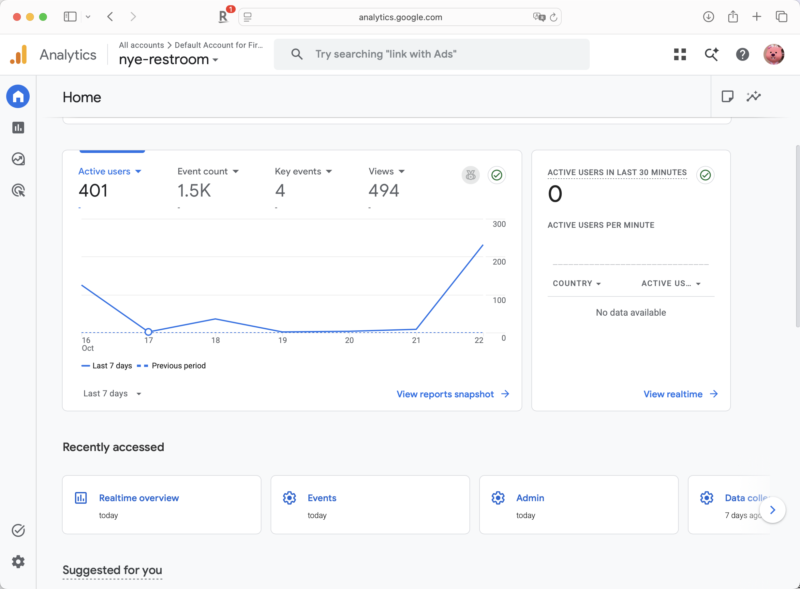
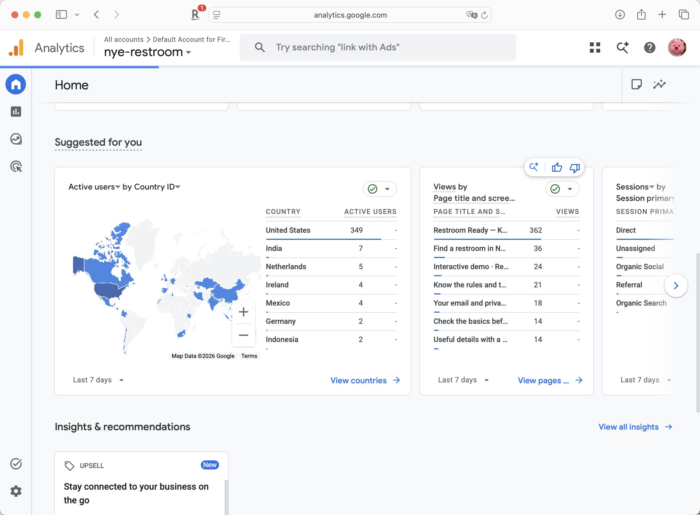
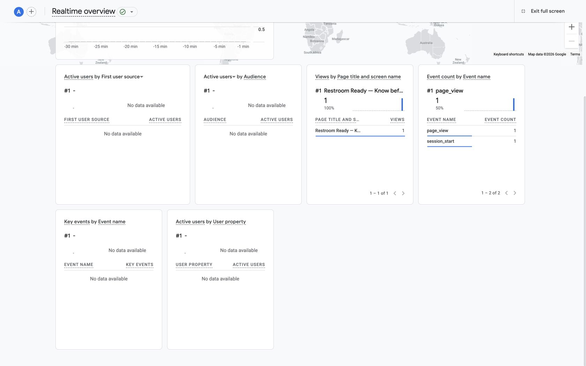

# HW6 — Analytics verification

**Five Girls · Restroom Ready · October 23, 2026**

**Owner:** Zheli Chen

The [semester demand plan](demand_strategy.md) was merged in Ciarrah Wang’s PR #52. This follow-up adds the Analytics verification and current product updates on top of that merged plan.

## Existing setup

We use the existing Google Analytics account **Default Account for Firebase**, property **nye-restroom** (`559243633`), and **Restroom Ready Web** stream. The deployed measurement ID is **`G-YJG2N05KY9`**. We reused this setup instead of creating a second property. The live checks below cover the website. The new native Analytics implementation has passed model tests but still needs a Firebase-linked build and TestFlight upload; the installed 1.0 (7) build does not contain it.

At **12:28 PM Eastern on October 23**, all eight public routes returned HTTP 200 and referenced the shared JavaScript containing the configured Google tag:

| Page | Public URL | Tag present |
| --- | --- | --- |
| Homepage | https://nyc.imfinethanku.me/ | Yes |
| Conditions | https://nyc.imfinethanku.me/conditions/ | Yes |
| Entry and route | https://nyc.imfinethanku.me/entry-route/ | Yes |
| Dated reports | https://nyc.imfinethanku.me/dated-reports/ | Yes |
| Thank-you | https://nyc.imfinethanku.me/thank-you/ | Yes |
| Sample demo | https://nyc.imfinethanku.me/demo/ | Yes |
| Privacy | https://nyc.imfinethanku.me/privacy/ | Yes |
| Public finder | https://nyc.imfinethanku.me/find/ | Yes |

## Signup event

The conversion is **first-time Google account creation**, emitted as **`sign_up`** with `method=google`. The website reads Firebase Authentication’s successful credential result and emits the event only when `isNewUser` is true and the result belongs to the current account. Returning logins, restored sessions, canceled or failed sign-ins, legacy email forms and thank-you-page visits do not emit this event. Firebase is shared by both clients: an account created on the website is not a new account again on iPhone.

On October 23, `sign_up` was registered **with code**, marked as a property-wide key event, counted once per event and given no default monetary value. It therefore applies to both web and iOS streams when they send that name. The old `generate_lead` key-event flag and the two incorrect web modification rules were removed. Historical lead data is preserved and is not relabeled as account signups.

No genuine new-account event has been verified in Realtime yet. The newly registered key-event row shows “No stream data detected”; registering an event does not manufacture a signup.

## Seven-day traffic overview

The team's Google Analytics Home screenshots show **October 16–22, 2026**:

| Metric | Reported value |
| --- | ---: |
| Active users | 401 |
| Views | 494 |
| Event count | 1.5K |
| Key events | 4 |

The second screenshot shows the country, page and traffic-channel breakdown for the same seven-day range. Its page table includes 362 homepage views, 36 finder views and 24 sample-demo views.

These are property-wide Analytics figures. They can include team and QA activity and do not establish campaign-attributed traffic, new Google accounts or restroom use. In particular, **four key events do not establish four distinct signups**.

## Setup check

At approximately **1:17 PM Eastern on October 23**, a fresh Realtime overview showed one homepage `page_view` and one `session_start` after a visit labeled `utm_source=verification&utm_medium=qa&utm_campaign=hw6_realtime_check&utm_content=post_merge`. The active-user card still showed zero at capture time; the event table supplies the collection evidence. This visit is QA traffic, not acquisition. No production account, signup conversion or confirmation email was created.

The seven-day screenshots above supply historical traffic context. They do not replace this Realtime collection check or establish successful new-account conversions.

## Attribution and validation

Our campaign convention uses lowercase UTM keys and values. The semester plan defines `utm_campaign=hw6_fall2026`; its examples remain planned until their posts are published. Existing HW5 links keep their original campaign labels. Analytics excludes emails, account identifiers, notes, passcodes, search text and precise coordinates.

All **six Analytics tests**, TypeScript and the production web build passed on October 23. Checks cover new versus returning accounts, missing or non-Google metadata, stale-account results, duplicate callbacks, private data exclusion and direct thank-you visits. Analytics metadata and transport failures cannot turn a completed sign-in into a failure. The **33 Swift model tests** also passed, including the two new-account guard tests. Native SDK compilation and device collection remain pending while the Mac Studio is unreachable.

The new conversion definition starts with this update. Do not compare the earlier waitlist-lead total directly with account signup totals or report the historical four key events as four accounts. Browser blocking or network failure can make Analytics undercount; Firebase account-creation records establish actual new accounts. Account creation is not newsletter consent, an installation or a restroom visit.

Source: [CourseWorks HW6, Parts 1–2 and folder layout](https://courseworks2.columbia.edu/courses/258234/assignments/1745725), read October 23. The assignment requires one team PR containing `demand_strategy.md`; Analytics Academy 101/102 are explicitly optional. The follow-up preserves the merged demand plan and adds this supporting verification record.
