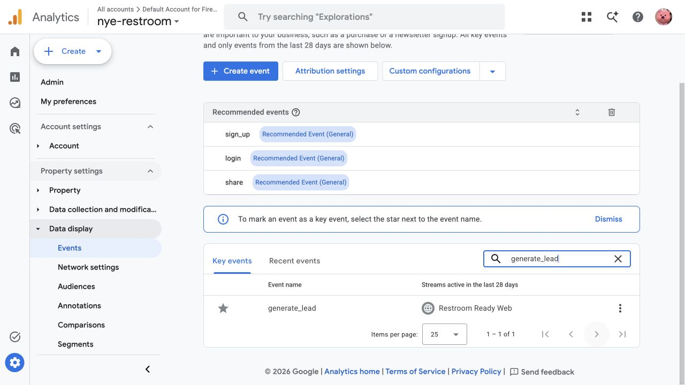
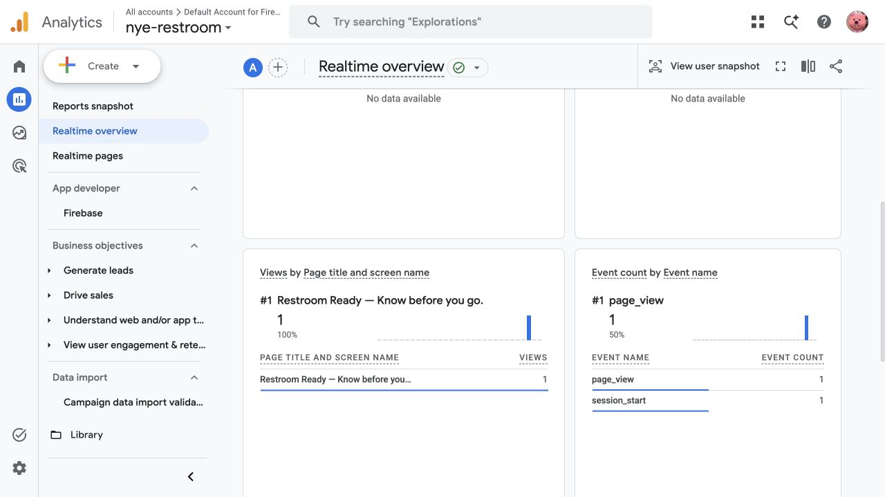

# HW6 — Analytics verification

**Five Girls · Restroom Ready · October 23, 2026**

**Owner:** Zheli Chen

The [semester demand plan](demand_strategy.md) and this Part 2 verification are included in one team PR. The plan retains Ciarrah Wang's weekly ownership, publishing calendar and acquisition assumptions.

## Existing setup

We use the existing Google Analytics account **Default Account for Firebase**, property **nye-restroom** (`559243633`), and **Restroom Ready Web** stream. The deployed measurement ID is **`G-YJG2N05KY9`**. We reused this setup instead of creating a second property. These checks cover the website; native iPhone Analytics is not enabled.

At **12:28 PM Eastern on October 23**, all eight public routes returned HTTP 200 and referenced the shared JavaScript containing the configured Google tag:

| Page | Public URL | Tag present |
| --- | --- | --- |
| Homepage | https://nyc.imfinethanku.me/ | Yes |
| Conditions | https://nyc.imfinethanku.me/conditions/ | Yes |
| Entry and route | https://nyc.imfinethanku.me/entry-route/ | Yes |
| Dated reports | https://nyc.imfinethanku.me/dated-reports/ | Yes |
| Thank-you | https://nyc.imfinethanku.me/thank-you/ | Yes |
| Sample demo | https://nyc.imfinethanku.me/demo/ | Yes |
| Privacy | https://nyc.imfinethanku.me/privacy/ | Yes |
| Public finder | https://nyc.imfinethanku.me/find/ | Yes |

## Signup and key event

After `/api/waitlist` confirms a successful submission, the browser records a one-time confirmation and navigates to `/thank-you/`. That page emits **`generate_lead`** and consumes the confirmation. Opening thank-you directly or reloading a consumed confirmation does not create another lead. Failed submissions keep the form error and do not emit the event.

The authenticated Analytics **Key events** view was checked again on October 23: **`generate_lead` is starred**, and its stream is **Restroom Ready Web**. Its existing setting was retained.

## Realtime check

We opened one homepage visit with lowercase labels:

`utm_source=verification&utm_medium=qa&utm_campaign=hw6_analytics_check&utm_content=homepage`

The authenticated Realtime report then displayed **one homepage view**, **one `page_view`**, and **one `session_start`**. This proves receipt of a current website visit. It is QA traffic and must be excluded from acquisition results. No production signup or confirmation email was created for this check.

## Attribution and validation

Our campaign convention uses lowercase UTM keys and values. The semester plan defines `utm_campaign=hw6_fall2026`; its examples remain planned until their posts are published. Existing HW5 links keep their original campaign labels. Analytics excludes emails, account identifiers, notes, passcodes, search text and precise coordinates.

All **six Analytics tests and five waitlist tests passed** on October 23. Isolated checks cover successful submission, invalid/failing requests, direct thank-you visits and reload deduplication without creating public conversions.

`generate_lead` counts completed successful submission flows, including an already-subscribed address. Distinct stored email records are needed to count unique signups. This verification does not claim campaign results, customer adoption or a genuine restroom visit.

Source: [CourseWorks HW6, Parts 1–2 and folder layout](https://courseworks2.columbia.edu/courses/258234/assignments/1745725), read October 23. The assignment requires one team PR containing `demand_strategy.md`; Analytics Academy 101/102 are explicitly optional. The combined PR includes the required demand-plan file and this supporting verification record.
